# Lotería Push

---

## R02. Baraja y líneas

Rojo: las pruebas de baraja y líneas fallan inicialmente antes de completar su implementación[cite: 3].

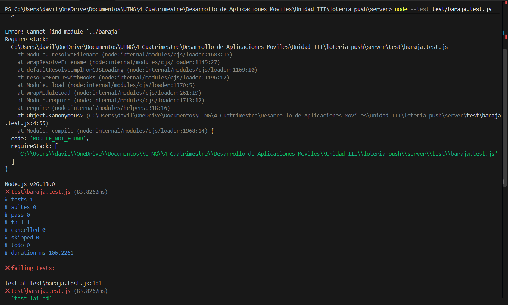

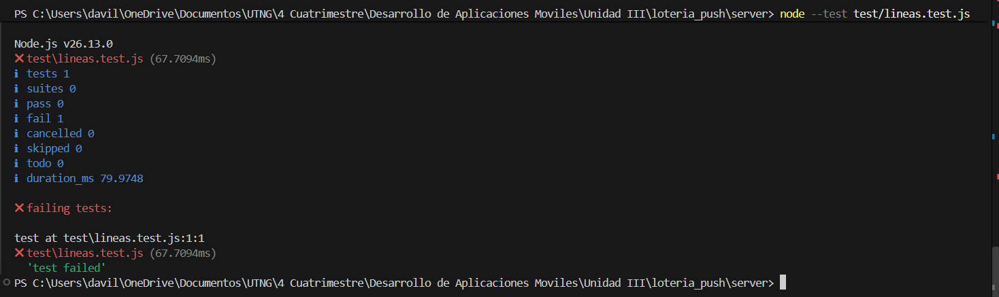

Verde: se implementa la lógica de baraja y líneas, y pasan las pruebas

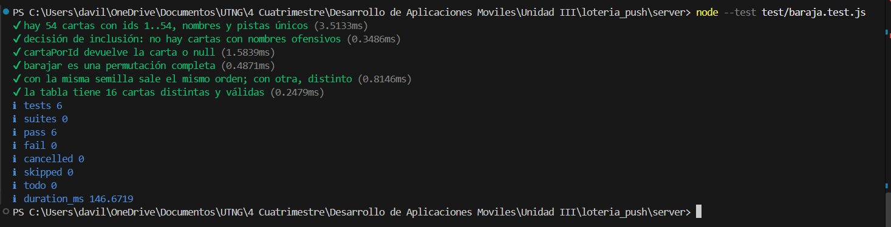

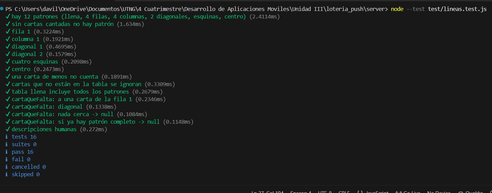

---

## R03. Mensajes

Rojo: la prueba de mensajes falla inicialmente antes de completar su implementación

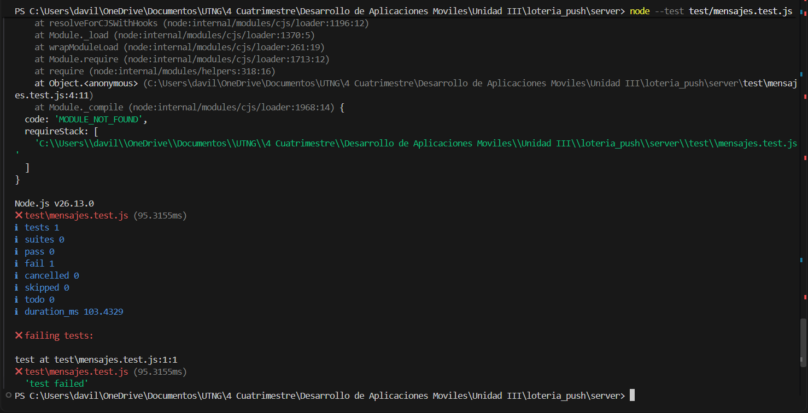

Verde: se implementa el manejo de mensajes, y pasa la prueba

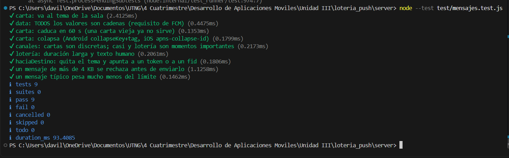

---

## R04. Sala

Rojo: la prueba de sala falla inicialmente antes de completar su implementación

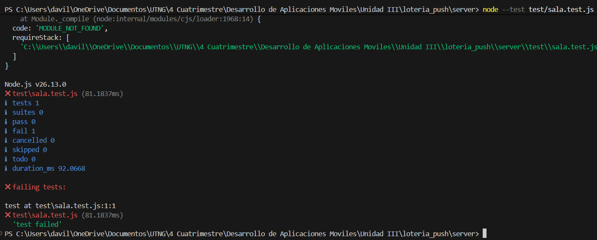

Verde: se implementa la lógica de sala, y pasa la prueba

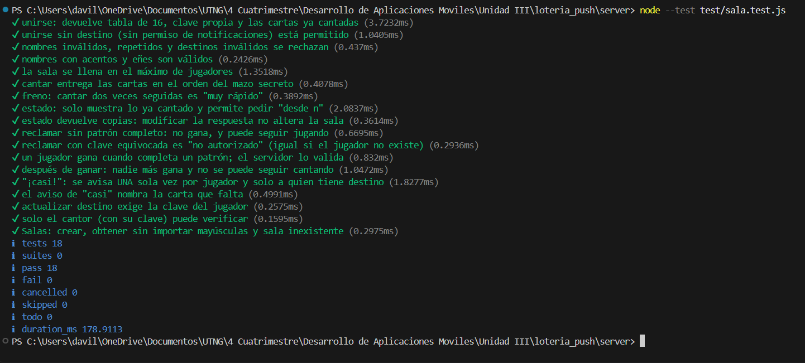

---

## R05. Servidor

Rojo: la prueba de servidor falla inicialmente antes de completar su implementación

Verde: se implementa la comunicación con el servidor, y pasa la prueba

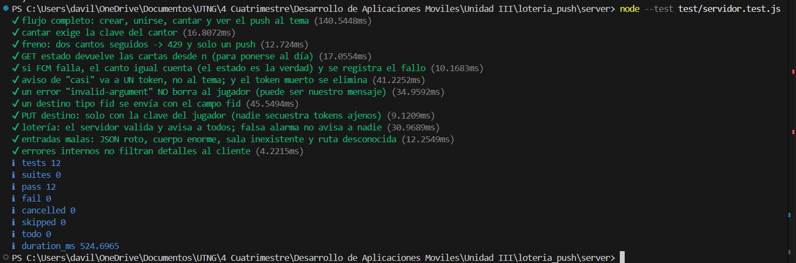

---

## R06. Evento líneas y partida

Rojo: las pruebas de evento de líneas y partida fallan inicialmente antes de completar su implementación

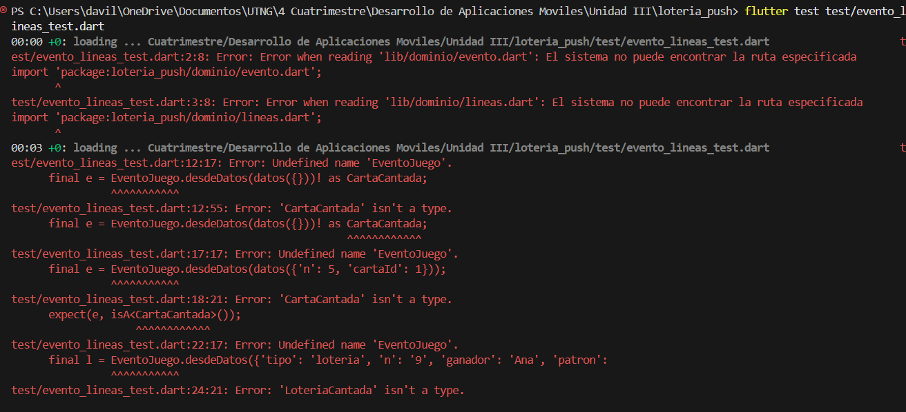

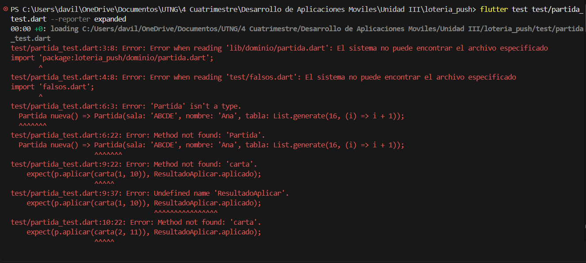

Verde: se implementan el evento de líneas y la partida, y pasan las pruebas

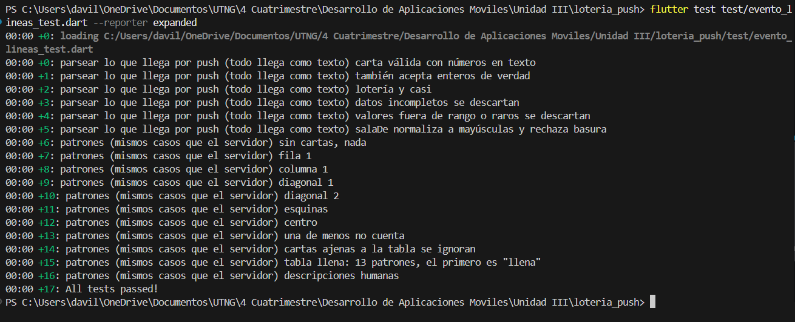

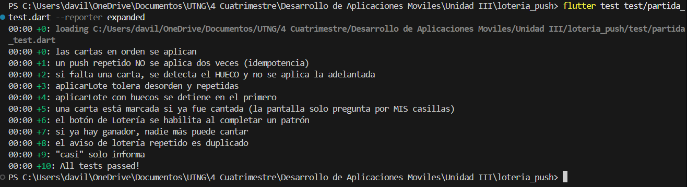

---

## R07. Controlador

Rojo: la prueba del controlador falla inicialmente antes de completar su implementación

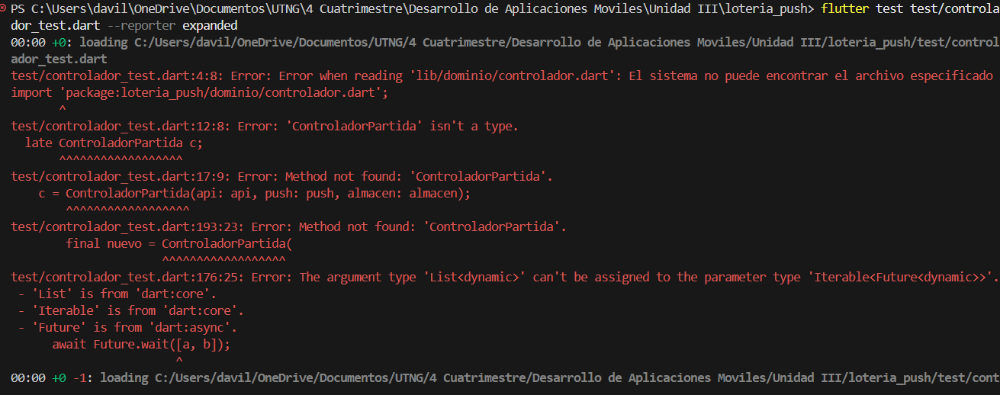

Verde: se implementa el controlador, y pasa la prueba

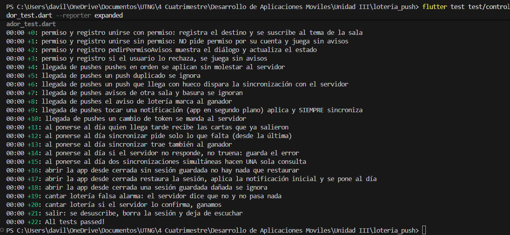
